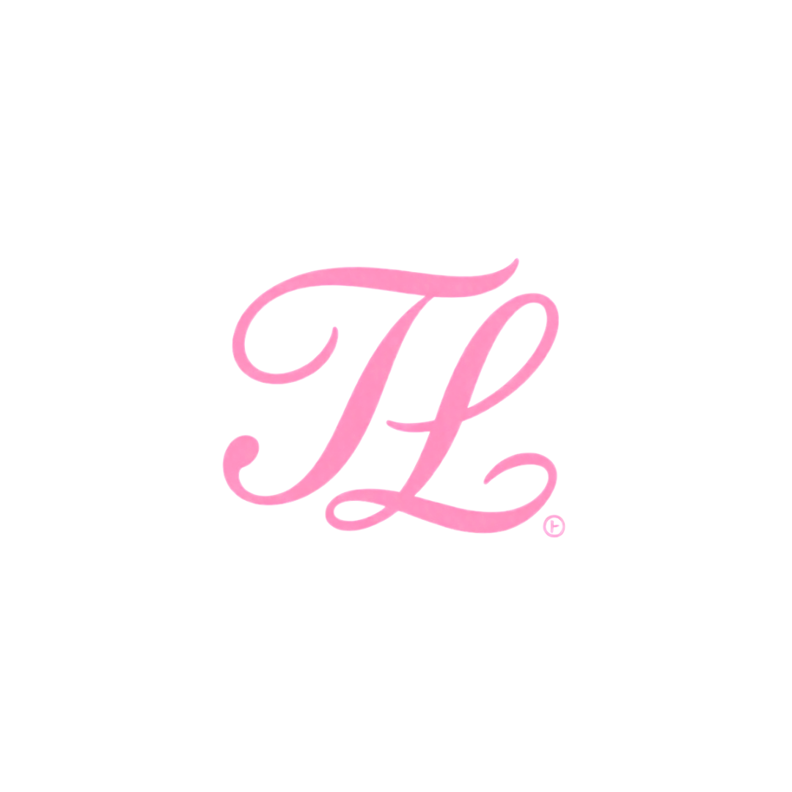

<div align="center">


<br>



<br>

**Design • Tecnologia • Criatividade**

</div>

---

# 🌸 Sobre o Portfólio

Bem-vindo(a) ao meu portfólio!

Sou **Thauanne Luna**, estudante de Ensino Médio Técnico em Informática, com interesse nas áreas de **Design Gráfico, Identidade Visual, Branding e Desenvolvimento Web**.

Este espaço foi desenvolvido para reunir e apresentar minha trajetória, meus conhecimentos, experiências e projetos criativos.

Mais do que uma galeria de trabalhos, este portfólio representa minha evolução, meu processo de aprendizado e a maneira como conecto design e tecnologia para transformar ideias em projetos com identidade e propósito.

---

# 👩🏻‍💻 Sobre mim

Sou uma pessoa criativa, curiosa e interessada em explorar diferentes possibilidades dentro do universo do design e da tecnologia.

Minha trajetória combina formação técnica em Informática, experiências com criação gráfica, desenvolvimento de interfaces e construção de projetos autorais.

Também sou fundadora da **Thau Luna Studio**, marca que reúne minhas iniciativas criativas nos universos físico e digital.

Atualmente, meus principais interesses são:

- 🎨 Design Gráfico
- 💎 Identidade Visual e Branding
- 🌐 Desenvolvimento Web
- 📱 UI Design
- 🧩 UX Design
- ✨ Direção Criativa
- 📚 Projetos Editoriais
- 💻 Experiências Digitais

> **Acredito que um bom projeto precisa unir estética, propósito e funcionalidade.**

---

# 🧠 Minha abordagem criativa

```text
IDEIA       → identificar possibilidades
ESTRATÉGIA  → compreender objetivos e necessidades
DESIGN      → construir uma identidade visual
TECNOLOGIA  → transformar ideias em experiências
DETALHES    → aperfeiçoar cada elemento
EVOLUÇÃO    → aprender, testar e desenvolver

✦ Princípios

- Criatividade com propósito
- Atenção aos detalhes
- Organização visual
- Aprendizado contínuo
- Pensamento analítico
- Identidade e originalidade
- Funcionalidade
- Evolução profissional

---

🛠️ Habilidades & Ferramentas

🎨 Design Gráfico

<div align="center">
</div>- Criação de materiais gráficos
- Identidade visual
- Composição e hierarquia visual
- Branding
- Materiais para redes sociais
- Design de peças personalizadas

💻 Desenvolvimento Web

<div align="center"></div>- HTML
- CSS
- JavaScript
- Estruturação de páginas
- Estilização de interfaces
- Desenvolvimento Front-end
- Versionamento com Git e GitHub

📱 Interfaces & Plataformas

<div align="center">

</div>---

📂 Projetos em Destaque

Uma seleção de projetos que representam minhas experiências em design, desenvolvimento web, criação de marcas e projetos autorais.

🌸 Thau Luna Studio

Marca própria · Identidade visual e presença digital

Marca criativa em constante evolução, que reúne diferentes formas de expressão, criação e empreendedorismo.

Surgiu a partir da Thau Luna Acessórios e evoluiu para um estúdio que conecta produtos físicos, serviços criativos e soluções digitais.

Áreas exploradas:

- Identidade visual e branding
- Design gráfico
- Produtos personalizados
- Desenvolvimento de sites
- Comunicação visual
- Empreendedorismo criativo

🌐 "Acessar o site" (https://thaulunastudio.lovable.app/)

📸 "Instagram" (https://www.instagram.com/thauluna_studio/)

---

📚 Luna's Library

Projeto autoral · Plataforma digital e publicação editorial

Plataforma independente dedicada à literatura, leitura digital e descoberta de livros.

Um projeto que une desenvolvimento web, experiência do usuário, identidade visual e storytelling.

Áreas exploradas:

- Desenvolvimento Front-end
- Interface e experiência do usuário
- Catálogo e busca de livros
- Leitura digital
- Autenticação e integração com Supabase
- Recursos interativos e comunidade

🌐 "Acessar o projeto" (https://thauanneluna.github.io/Lunas_Library/)

📸 "Instagram" (https://www.instagram.com/lunaslibraryapp/)

---

🏢 Vasconcelos Group

Projeto conceitual · Site institucional

Projeto de desenvolvimento web criado para uma empresa fictícia, explorando a construção de uma presença institucional no ambiente digital.

Áreas exploradas:

- Estruturação de site institucional
- Organização de conteúdo
- Design de interface
- Composição visual
- Desenvolvimento web

---

🎁 World Perfect Personalizados

Projeto web · Negócio real

Projeto de desenvolvimento web relacionado a uma loja existente de produtos personalizados.

Uma experiência voltada à apresentação digital do negócio e à organização visual de suas informações.

Áreas exploradas:

- Desenvolvimento web
- Apresentação de produtos
- Organização de informações comerciais
- Interface e navegação
- Comunicação visual

🌐 "Acessar o projeto" (https://thauanneluna.github.io/WorldPerfect/)

---

🐺 Teen Wolf — Beacon Hills

Projeto de fã · Desenvolvimento web

Site de fã inspirado no universo da série Teen Wolf, desenvolvido como exercício criativo e de programação.

Áreas exploradas:

- HTML e CSS
- Layout temático
- Organização de conteúdo
- Composição visual
- Interatividade
- Storytelling

🌐 "Acessar o projeto" (https://thauanneluna.github.io/TeenWolf/)

---

🏰 Enrolados — Reino de Corona

Projeto de fã · Desenvolvimento web

Experiência digital inspirada no universo da animação Enrolados, explorando a construção de uma interface temática e elementos visuais relacionados à história.

Áreas exploradas:

- HTML e CSS
- Direção visual
- Layout temático
- Organização de conteúdo
- Experiência de navegação
- Storytelling

🌐 "Acessar o projeto" (https://thauanneluna.github.io/Enrolados/)

---

🎓 Formação & Experiências

Ensino Médio Técnico em Informática

Formação técnica com experiências envolvendo tecnologia, desenvolvimento web, projetos acadêmicos e criação digital.

Experiência prática

Vivência em ambiente gráfico, com atividades relacionadas a:

- Edição de materiais no CorelDRAW
- Preparação de arquivos para impressão
- Criação de cartões, panfletos e crachás
- Digitalização e organização de documentos
- Acabamento de materiais gráficos

Projetos acadêmicos

Participação em atividades e projetos envolvendo tecnologia, criatividade, organização de informações e desenvolvimento de soluções digitais.

---

🎯 Objetivos Profissionais

- Aprimorar conhecimentos em Design Gráfico e Branding.
- Evoluir no desenvolvimento Front-end.
- Aprofundar conhecimentos em UI/UX.
- Desenvolver interfaces mais completas e funcionais.
- Expandir a Thau Luna Studio.
- Criar novos projetos autorais.
- Construir uma trajetória profissional que conecte design e tecnologia.

---

📊 GitHub

<div align="center"><br><br>

</div>---

🌍 Idiomas

- 🇧🇷 Português — Nativo
- 🇪🇸 Espanhol — Intermediário
- 🇺🇸 Inglês — Básico

---

📫 Contato

<div align="center"><a href="mailto:luna.thauannedesign@gmail.com">

</a><a href="https://www.linkedin.com/in/thauanne-luna-30b4833b5">

</a><a href="https://github.com/thauanneluna">

</a><a href="https://www.instagram.com/thauluna_studio">

</a><a href="https://thauanneluna.github.io/PortflioThauanne/">

</a></div>---

✨ Além do código e do design

Acredito que cada projeto é uma oportunidade de aprender, experimentar e desenvolver novas habilidades.

Gosto de unir referências, criatividade e tecnologia para construir soluções que tenham personalidade e façam sentido.

Meu objetivo é continuar evoluindo, criando e transformando ideias em experiências visuais e digitais.

---

<div align="center">Thauanne Luna

Design • Tecnologia • Criatividade

<sub>© 2026 · Construindo ideias, criando possibilidades.</sub>

</div>
```
